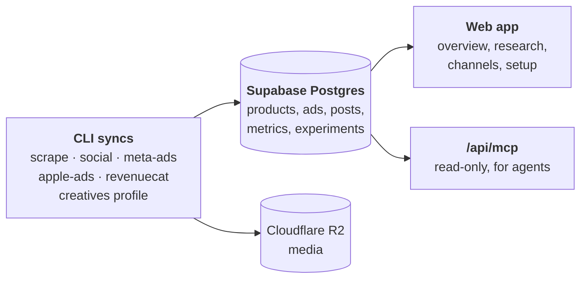

<div align="center">


# Mad Factory

**Open-source agents for marketing and ads.**<br>
Watch your competitors, run your Meta and Apple Ads, and make your next ads and posts.<br>
Self-hosted. You approve every change.

[](LICENSE)


[Quick start](#quick-start) · [How it works](#how-it-works) · [Integrations](#keys-and-integrations) · [Agents](#working-with-ai-agents) · [Feature map](docs/feature-map.md)

</div>

## TL;DR

- **Automates Meta Ads and Apple Ads** for apps: syncs your campaigns, spend and revenue (RevenueCat), tracks
  competitor ads and reels, and puts one number on top: monthly profit against your goal. Google Ads and SEO are next.
- **Built to iterate fast without getting banned.** Data from ad platforms is fetched **once a day** by read-only
  syncs, and every analysis reads the database, never the platform API. No polling, no scraping on every question.
- **Changes go through experiments and playbooks.** Every campaign that spends money belongs to an experiment with
  rules; an agent applies the playbook, drafts a plan, you approve it in chat, and only then is the ad account
  changed. Every write is journaled; nothing is ever deleted.

<div align="center">

</div>

## Experiments, playbooks and how campaigns change

```
ad platform ──(daily sync, read-only)──► Postgres ──► agent reads pnpm brief ──► plan ──► you approve ──► write
     ▲                                                                                                    │
     └──────────────────────────── journaled change + dated line in the experiment log ◄─────────────────┘
```

- **Experiments** are the unit of memory. Each one says what is being tested, its budget and dates, the rules that
  decide it (for example "pause an ad that spent 3× what a trial is worth without getting one") and, when it ends,
  what was learned.
  Every decision, observation and follow-up is a dated line in its log, so "where are we?" has an answer any day.
  `pnpm experiment list --product <slug>`.
- **Playbooks** ([playbooks/](playbooks)) are the generic operating method agents follow:
  [daily-review.md](playbooks/daily-review.md) (the once-a-day routine: read the brief, apply each experiment's
  rules, log, draft plans), plus [meta-ads.md](playbooks/meta-ads.md) and [apple-ads.md](playbooks/apple-ads.md)
  for channel structure and defaults.
- **Plans** are documents in the database. An agent writes one with one reason per change, you say yes in chat,
  then a write command (`pnpm meta-ads pause|activate|launch|...`) applies it from your machine. Pacing is part of
  the rules: at most a 20% budget or bid change, once per ad set or keyword per 24 hours.

The full model is in [docs/marketing-loop.md](docs/marketing-loop.md).

## What's built and what's next

| Channel | Status | What it does |
|---|---|---|
| **Meta Ad Library** | ✅ Built | Tracks competitor pages and search keywords, downloads every ad's video or image, and records each ad's rank and status on every run, so long-running ads stand out. Sources are tagged as competitors or inspiration from nearby niches. `pnpm scrape` |
| **Organic** | ✅ Built | Instagram, TikTok and Facebook reels from competitor, inspiration and your own accounts, with views tracked over time so outlier posts float up. `pnpm social` |
| **Meta Ads** | ✅ Built | Syncs your own ad account (campaigns, ad sets, ads, creatives, daily numbers by country). It can pause, activate, create paused ads and launch tests, each from a plan you approve first and journaled before it is sent. It never deletes. `pnpm meta-ads` |
| **Apple Ads** | ✅ Built | Syncs your campaigns, keywords and search terms per country, every day. Changes are drafted as a plan for you to apply. `pnpm apple-ads` |
| **RevenueCat** | ✅ Built | Trials and proceeds, so the overview shows profit against your monthly goal. `pnpm revenuecat` |
| **Creative analysis** | ✅ Built | Gemini breaks each stored video or image into its hook, script, angle and production style. `pnpm creatives profile` |
| **Google Ads** | 🛠 Next | Your own Google Ads campaigns (Search and video): spend, keywords and conversions, synced like Meta and Apple Ads. |
| **SEO** | 🛠 Next | Search rankings and organic traffic for your site and app store pages. |

**Automations.** The syncs and the daily review (`playbooks/daily-review.md`) run on a schedule. Today that
schedule is a Devin automation (see [What Devin does here today](#what-devin-does-here-today)) and isn't part of
this repository. Every step is a plain `pnpm` command, so cron, GitHub Actions or any agent that can run a shell
works too.

## How it works



The commands hold the API keys and write to the database. The web app only reads it, so a hosted web server never
needs your ad-account keys.

## Quick start

You need Node 22.6+ and pnpm. Supabase is the only required service, and its free plan is enough.

```bash
pnpm install
cp .env.example .env          # fill in SUPABASE_URL and SUPABASE_SERVICE_ROLE_KEY
pnpm doctor                   # what is configured, what each missing key would turn on
pnpm db:migrate               # creates the tables (needs SUPABASE_DB_URL; or: supabase db push)
pnpm product create --file examples/product.example.json
echo "AUTH_DISABLED=true" >> .env   # local only: skip GitHub sign-in for `pnpm web`
pnpm web                      # http://localhost:3000
```

The web app works from the first step. A page whose channel is not set up says so, and the overview lists the
commands that connect each channel. `/setup` shows which keys the server has; it shows names only, never values.

No database yet? `pnpm db:migrate:local` runs every migration on an embedded Postgres (PGlite) to check the
schema without one.

## Keys and integrations

Put keys in `.env` at the repository root. The web app reads the same file. Only Supabase is required. Without a
key, its feature stays off, and the command that needs it says which key to set and where to get it.
`pnpm doctor` checks all of them.

| Integration | Turns on | Variables | Without it |
|---|---|---|---|
| **Supabase** (required) | The database for everything | `SUPABASE_URL`, `SUPABASE_SERVICE_ROLE_KEY` | Nothing runs |
| Database migrations | `pnpm db:migrate` | `SUPABASE_DB_URL` (Session pooler URI) | Use `supabase db push` |
| ScrapeCreators | Competitor ads (`pnpm scrape`) and organic posts (`pnpm social`) | `SCRAPECREATORS_API_KEY` | `pnpm scrape --collector playwright` uses a local browser instead; no organic sync |
| Cloudflare R2 | Media storage, so the web app can play videos | `R2_ACCOUNT_ID`, `R2_ACCESS_KEY_ID`, `R2_SECRET_ACCESS_KEY`, `R2_BUCKET`, optional `R2_PUBLIC_URL` | Media is saved to `./data/media`; the web app shows placeholders |
| Proxy | A rotating proxy for the browser collector | `PROXY_URL` | Direct connection |
| Meta Ads | Your own Meta ad account (`pnpm meta-ads`) | `META_ADS_TOKEN` | The Meta ads tab stays empty |
| Apple Ads | Your Apple Ads campaigns (`pnpm apple-ads`) | `APPLE_ADS_DIR`, or `APPLE_ADS_CLIENT_ID`, `APPLE_ADS_TEAM_ID`, `APPLE_ADS_KEY_ID`, `APPLE_ADS_PRIVATE_KEY` | The Apple ads tabs stay empty |
| RevenueCat | Trials and revenue, so the overview shows profit (`pnpm revenuecat`) | `REVENUECAT_API_KEY` | Spend without revenue or profit |
| Google Gemini | AI breakdowns of creatives (`pnpm creatives profile`) and the web Transcribe button on organic posts | `GEMINI_API_KEY` | The Creatives tab stays empty; posts can't be transcribed |
| Vercel AI Gateway | `google/…` model ids for creative profiles | `AI_GATEWAY_API_KEY` | Gemini is called directly |
| Web sign-in (GitHub) | Sign in to the hosted web app | `AUTH_GITHUB_CLIENT_ID`, `AUTH_GITHUB_CLIENT_SECRET`, `AUTH_SECRET`, `AUTH_ALLOWED_GITHUB_IDS`, optional `AUTH_URL` | The web app serves only `/setup`; `AUTH_DISABLED=true` skips sign-in in local `next dev` |

`.env.example` explains where to get each key. On a hosted web server, set only the Supabase and `AUTH_*`
variables, plus `GEMINI_API_KEY` for the Transcribe button. Keep ad-account keys on the machine that runs the syncs, so a stolen web session has nothing that can
change a campaign.

## Using it

Each product is something you market. Connect a channel by adding a tracked source to the product, then run its
sync:

```bash
# Competitor ads from the Meta Ad Library
pnpm product add-source example-product --kind page --value <facebook page id> --country US
pnpm product add-source example-product --kind keyword --value "search phrase"
pnpm scrape --product example-product --max 200

# Instagram, TikTok and Facebook accounts (relation: competitor, inspiration or own)
pnpm product add-source example-product --source tiktok --kind account --value example_handle --country ALL \
  --config '{"relation":"competitor"}'
pnpm social --product example-product

# Your own ad accounts and revenue
pnpm product add-source example-product --source meta_ads --kind ad_account --value act_<id>
pnpm meta-ads sync --product example-product
pnpm product add-source example-product --source apple_ads --kind app --value <App Store ID> \
  --config '{"ad_account_id": <id>}'
pnpm apple-ads sync --product example-product
pnpm product add-source example-product --source revenuecat --kind project --value <project id>
pnpm revenuecat sync --product example-product

# The goal and where you stand
pnpm scorecard goal --product example-product --target 5000
pnpm brief --product example-product

# AI breakdowns of every stored video and image
pnpm creatives profile --product example-product
```

Every command has `--help`. [docs/feature-map.md](docs/feature-map.md) lists every command and page: what it
reads and writes and what each run costs in API calls.

### Changing an ad account

Most commands only read. The Meta write commands (`pause`, `activate`, `adset-update`, `create-ad`, `ad-text`,
`launch`) each need a reviewed plan document in `product_docs`, and every request is journaled before it is sent. Read one with
`pnpm product docs show <slug> <name>`; add or update one with `pnpm product docs add <slug> --kind plan --file <path>`.
New ads are always
created paused. Nothing in the code can delete or archive a campaign, ad set, ad or creative. The web app and the
MCP server cannot change an ad account at all.

## Web app

`pnpm web` starts it at http://localhost:3000. It has:

- an overview with the goal, channels, ads by spend, own posts, experiments and data freshness
- Competitor ads, Organic and Creatives for research
- Meta ads, Apple ads, Apple keywords and My accounts for your own channels
- Brand, for the product's profile and brand/research documents (`product_docs`; `pnpm product docs import|add|show|export`)

Hosted, it signs in with GitHub and lets in only the numeric GitHub user IDs in `AUTH_ALLOWED_GITHUB_IDS` (an ID never changes, a username can be renamed and taken by someone else; find yours at `https://api.github.com/users/<username>`).

### MCP for agents

`/api/mcp` is a read-only [MCP](https://modelcontextprotocol.io) server (Streamable HTTP). Each agent gets its own
key and sends `Authorization: Bearer <key>`:

```bash
pnpm mcp-key create --name my-agent   # prints the key once; only its SHA-256 is stored
pnpm mcp-key list
pnpm mcp-key revoke --name my-agent
```

The tools are `start_here`, `brief`, `recent_activity`, `experiments`, `experiment`, `apple_ads`, `meta_ads`,
`list_docs` and `read_doc`.

## Working with AI agents

The repository is set up for coding and marketing agents working side by side:

- [CLAUDE.md](CLAUDE.md) (also `AGENTS.md`) holds the rules every agent follows.
- [playbooks/](playbooks) holds the operating method: a daily review, plus Meta Ads and Apple Ads playbooks.
- `pnpm ready` runs every gate before a change merges: typecheck, tests, database types, and the repository's
  review rules.

### What Devin does here today

[Devin](https://devin.ai) does most of the day-to-day work. The rules it follows are the same ones in CLAUDE.md, so
Claude or Codex could do any of it.

- **Every morning, on a schedule.** A Devin automation starts a session once a day. The session follows a prompt
  that first runs the syncs as plain `pnpm` commands (Apple Ads, RevenueCat, Meta Ads, Ad Library, organic), each
  once with at most one retry. Then it follows `playbooks/daily-review.md`: it reads `pnpm brief`, checks each
  running experiment against its rules, drafts plans, logs observations and follow-ups, and sends a short report
  that is easy to read on a phone. That session never changes an ad account. Its prompt forbids write commands,
  and its network allowlist only reaches the APIs it syncs from. The only writes it makes are `experiment_log`
  rows.
- **Ad-account changes you approve in chat.** You ask for a change, Devin writes a plan to `product_docs`, and after
  you say yes it runs the write command (`pnpm meta-ads pause|activate|launch|...`). Every write is journaled before
  it is sent, and nothing is ever deleted.
- **Research.** Adding competitor and inspiration accounts, backfilling their ads and reels, and breaking down
  creatives with Gemini to find the hooks and angles that keep running.
- **Building Mad Factory itself.** Devin opens a branch and a PR for each change and runs `pnpm ready`. The owner
  merges.

## Development

```bash
pnpm ready          # typecheck, tests, db types, web typecheck, review rules
pnpm test           # node --test; migrations run on an in-memory PGlite Postgres
pnpm db:types       # regenerate src/db/database.types.ts after changing a migration
pnpm db:check       # quick connectivity test
pnpm db:audit       # post-scrape integrity checks on the live database
```

TypeScript runs directly on Node (type stripping): there is no build step and no native dependencies. See
[CLAUDE.md](CLAUDE.md) for the layout, the conventions and how to add a source.

## License

MIT. See [LICENSE](LICENSE).
